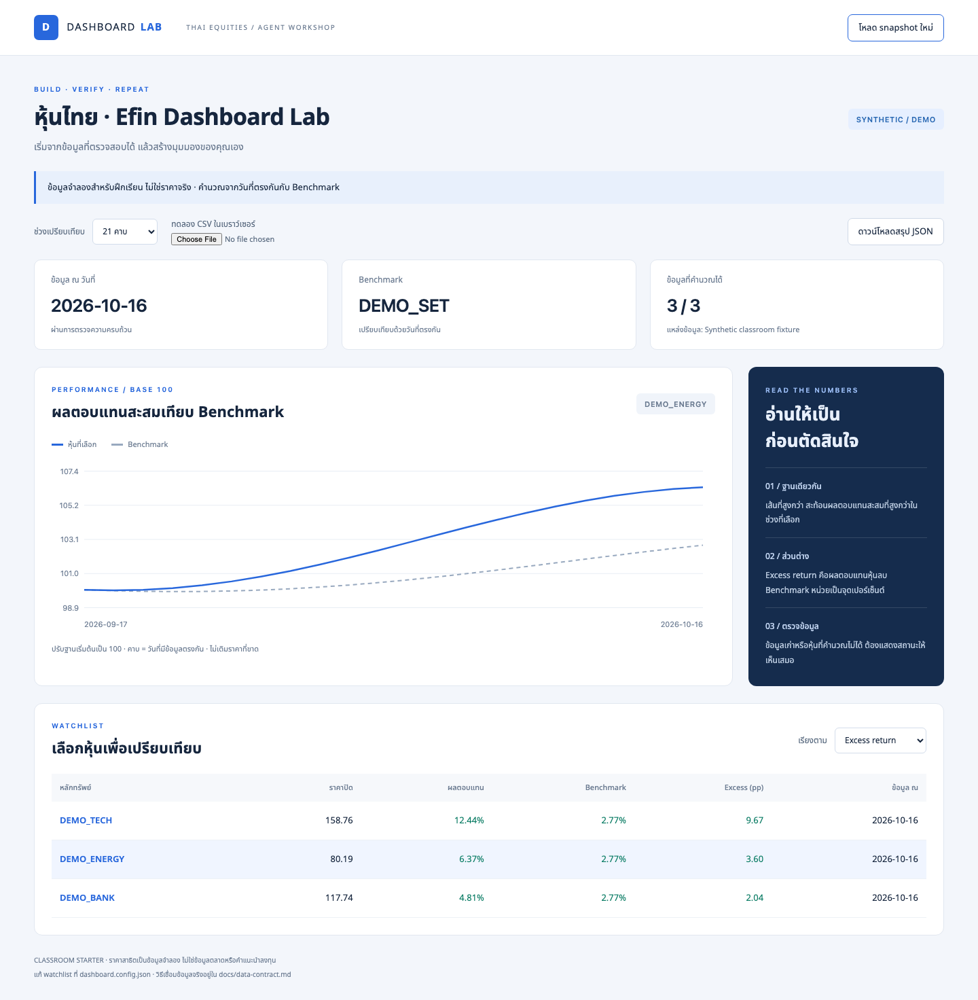

# Efin Dashboard Starter

เริ่มสร้าง Dashboard หุ้นไทยในคลาสด้วยโปรเจกต์ที่เปิดใช้ได้ทันที แล้วให้ AI ช่วยปรับจากโจทย์ของคุณ โดยใช้ Skills เดิมที่ติดตั้งอยู่ได้ ไม่ต้องแก้ทุก `SKILL.md`

**เริ่มจากข้อมูลจำลอง → เข้าใจตัวเลข → นำเข้า CSV ของตัวเอง → ปรับหน้าจอ → ทดสอบการอัปเดต**

[สร้างโปรเจกต์ของตัวเอง](https://github.com/nutdnuy/efin-dashboard-starter/generate) · [คู่มือคลาส](docs/class-guide.md) · [รูปแบบข้อมูล](docs/data-contract.md) · [ใช้ Skills เดิม](docs/upstream-skills.md)



## เปิดครั้งแรก

ต้องมี **Node.js 22 ขึ้นไป** และ npm ที่มากับ Node.js โปรเจกต์ใช้ความสามารถในตัว Node.js จึงไม่ต้องรัน `npm install` และไม่ต้องมี API key เพื่อเปิดตัวอย่าง

1. กด **Use this template → Create a new repository** ตั้งชื่อและเลือกบัญชีของตัวเอง ถ้าจะเก็บงานส่วนตัวให้เลือก Private
2. Clone repo ที่สร้าง หรือดาวน์โหลด ZIP แล้วเปิดโฟลเดอร์ใน terminal
3. รันจากโฟลเดอร์ที่มี `package.json`:

```bash
node --version
npm run doctor
npm start
```

เปิด [http://localhost:3100](http://localhost:3100) หยุดเซิร์ฟเวอร์ด้วย `Ctrl+C`

หน้าตัวอย่างใช้ `DEMO_BANK`, `DEMO_ENERGY`, `DEMO_TECH` เทียบกับ `DEMO_SET` ทั้งหมดเป็น **ข้อมูลสังเคราะห์เพื่อการเรียน** ไม่ใช่ราคาจริงและไม่ใช่ตัวแทนบริษัทใด

## เริ่มคุยกับ Agent

เปิด **โฟลเดอร์ root ของโปรเจกต์** ในแอป Agent แล้ววางข้อความนี้:

```text
อ่าน AGENTS.md และ README.md ของโปรเจกต์นี้
พาฉันเปิด Dashboard แล้วอธิบายข้อมูลจำลองและวิธีตรวจตัวเลขหนึ่งตัว
จากนั้นช่วยปรับ BRIEF.md ตามโจทย์ของฉัน โดยอ้างอิง templates/dashboard-brief.md
ใช้ Skills ที่ติดตั้งและอนุญาตให้เรียกอยู่แล้วเมื่อเหมาะสม
เก็บกติกาของคลาสไว้ในโปรเจกต์ ไม่แก้ Skills ต้นฉบับ
เริ่มจากงานเล็กหนึ่งอย่างที่ตรวจผลได้ แล้วทดสอบก่อนสรุปว่าเสร็จ
```

การเปิดเว็บไม่ต้องมี Skills หรือบัญชี AI ส่วนการให้ Agent ช่วยพัฒนาต้องใช้แอปและบัญชีของคุณเอง ดูความต่างระหว่างชื่อ Skills รุ่นเดิมกับ upstream ใน[คู่มือ Skills](docs/upstream-skills.md)

## มีอะไรให้ทดลอง

- กราฟเปรียบเทียบหุ้นกับ benchmark โดยปรับทั้งสองเส้นให้เริ่มที่ 100
- ผลตอบแทนหุ้น ผลตอบแทน benchmark และส่วนต่างในช่วงข้อมูลที่เลือก
- ข้อมูลจำลองสำหรับทดลองได้ทันที และการเลือก CSV ในเบราว์เซอร์เพื่อดูตัวอย่าง
- การนำเข้า CSV แบบบันทึกไว้ในเครื่อง พร้อมตรวจรูปแบบก่อนรับข้อมูล
- การปรับชื่อ Dashboard, benchmark, รายชื่อหุ้น และช่วงคำนวณจากไฟล์เดียว
- คู่มือและ templates สำหรับให้ Agent พัฒนาต่ออย่างมีเกณฑ์ตรวจรับ

นี่คือ starter เพื่อเรียนรู้การทำ Dashboard ไม่ใช่สูตร RRG เชิงพาณิชย์ และยังไม่มีตัวเชื่อม Efin API หรืองานตั้งเวลาที่เปิดใช้งานมาให้

## ใช้ข้อมูลของตัวเอง

เตรียม CSV ตาม[สัญญาข้อมูล](docs/data-contract.md) โดยมี `date,symbol,close` และ `volume` ถ้ามี:

```csv
date,symbol,close
2026-10-01,MY_STOCK,10
2026-10-01,MY_BENCHMARK,100
2026-10-02,MY_STOCK,10.5
2026-10-02,MY_BENCHMARK,101
```

ตัวอย่างด้านบนมีเพียง 2 วัน สำหรับทดลองตัวอย่างนี้ให้ตั้ง `symbols` เป็น `["MY_STOCK"]`, `benchmark` เป็น `"MY_BENCHMARK"` และ `lookbackPeriods` เป็น `1` ใน `dashboard.config.json` หากใช้ค่าเริ่มต้น 21 คาบ ต้องมีอย่างน้อย 22 วันที่ตรงกันต่อหุ้นและ Benchmark แล้วรัน:

```bash
npm run import -- "/path/to/input.csv"
npm start
```

ข้อมูลที่ผ่านการตรวจถูกเก็บใน `data/private/current.json` ซึ่งถูก Git ignore เลือก CSV บนหน้าเว็บเพื่อดูตัวอย่างได้ แต่การเลือกไฟล์ในเบราว์เซอร์ไม่ใช่การบันทึกแทนชุดข้อมูลหลักผ่าน CLI

สำหรับรอบถัดไป:

```bash
npm run refresh -- "/path/to/input.csv"
```

คำสั่งนี้อ่านและตรวจไฟล์ที่ระบุ ไม่ได้ดาวน์โหลดข้อมูลใหม่จาก Efin การรันซ้ำด้วยข้อมูลเดิมให้ชุดข้อมูลเดียวกัน จึงต้องจัดเตรียม CSV รอบใหม่จากแหล่งที่มีสิทธิ์ใช้งานก่อน ดู[วิธีวางงานอัปเดต](docs/scheduling.md)

## ปรับตรงไหน

| ต้องการเปลี่ยน | จุดที่เริ่ม |
|---|---|
| ชื่อหน้า หุ้น benchmark ช่วงข้อมูล และเกณฑ์ข้อมูลเก่า | `dashboard.config.json` |
| โจทย์และเกณฑ์ว่าทำสำเร็จแล้ว | [Dashboard brief](templates/dashboard-brief.md) |
| บริบทงานปัจจุบัน | [BRIEF.md](BRIEF.md) |
| โทนสี ระยะห่าง และตัวอักษร | public/styles.css |
| รูปแบบ CSV และความหมายของตัวเลข | [Data contract](docs/data-contract.md) |
| เลือกใช้ Skills เดิมให้เหมาะกับงาน | [Upstream skills](docs/upstream-skills.md) |
| วิธีเตรียมข้อมูลรอบใหม่และตรวจผล | [Scheduling](docs/scheduling.md) |

ค่าที่ปรับใน config คือ `title`, `benchmark`, `symbols`, `lookbackPeriods`, `staleAfterDays` ค่า lookback เริ่มต้น 21 ช่วง นับจากข้อมูลที่หุ้นและ benchmark มีวันที่ตรงกัน ไม่ใช่จำนวนวันปฏิทิน

## ตรวจงานก่อนส่ง

```bash
npm test
npm run check
npm run doctor
```

ใช้[รายการตรวจรับ](docs/acceptance-checklist.md) ดูหน้าจอและตรวจตัวเลขด้วย การผ่านคำสั่งเพียงอย่างเดียวไม่ได้ยืนยันว่าหน้าจออ่านง่ายหรือข้อมูลต้นทางถูกต้อง

## โครงสร้างที่ใช้ต่อได้

```text
AGENTS.md                  กติกาโปรเจกต์และ router กลาง
BRIEF.md                   โจทย์ปัจจุบัน
dashboard.config.json      หุ้น Benchmark และช่วงคำนวณ
.agents/skills/            workflow เฉพาะคลาส 1 ตัว (ไม่บังคับ)
docs/agents/               การตั้งค่าที่สกิล Matt อ่านได้
docs/ + templates/         คู่มือคลาส สัญญาข้อมูล เกณฑ์ตรวจรับ
prompts/                   ข้อความเริ่มงาน สร้าง ตรวจ และอัปเดต
src/                       ตัวอ่านข้อมูล สูตร และ snapshot
public/                    หน้าจอที่ปรับแต่งต่อได้
data/sample/               ข้อมูลจำลองพร้อม provenance
data/private/              ข้อมูลของคุณที่ไม่เข้า Git
tests/                     regression tests ของพฤติกรรมสำคัญ
```

อ่าน [prompts/01-start.md](prompts/01-start.md) เพื่อเริ่มใน Agent หรือเรียก `dashboard-class` หากแอปค้นพบสกิลในโปรเจกต์ ชื่อและวิธีเรียกอาจต่างกันตามแอป

## ที่มาของแนวทาง

โปรเจกต์นี้เขียนขึ้นใหม่สำหรับคลาสหุ้นไทย อ้างอิงแนวคิด Skills ขนาดเล็กที่ใช้ร่วมกันได้จาก [mattpocock/skills](https://github.com/mattpocock/skills) และรูปแบบ starter ที่รวม onboarding, workflow, ข้อมูล และ Dashboard จาก [Migchw/llm-wiki-starter](https://github.com/Migchw/llm-wiki-starter) ไม่ได้คัดลอกโค้ดหรือ Skills ของสอง repo มาไว้ในชุดนี้

ชื่อ Efin ใช้ระบุบริบทการเรียนและข้อมูลที่ผู้เรียนอาจนำเข้า โปรเจกต์นี้ไม่ได้มาพร้อมบัญชี สิทธิ์ข้อมูล หรือ API ของ Efin
