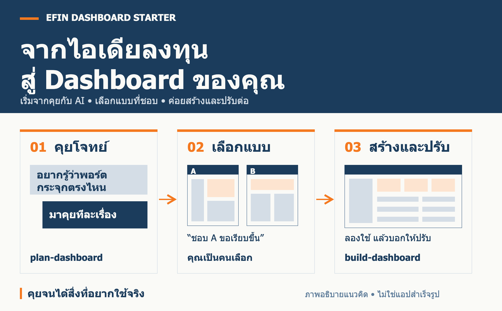

# Efin Dashboard Starter

**เล่าว่าอยากรู้อะไร → ให้ AI ทำแบบให้เลือก → สร้าง Dashboard ที่คุณอยากใช้**

ชุดเริ่มต้นสำหรับคลาส Efin ให้คุณคุยกับ AI เพื่อออกแบบและสร้าง Dashboard การลงทุนของตัวเอง ตั้งแต่โจทย์แรกจนเปิดลองและปรับต่อ ไม่ต้องเขียนสเปกครบก่อนเริ่ม

**[เริ่มโปรเจกต์ของฉัน ↗](https://github.com/nutdnuy/efin-dashboard-starter/generate)** · [คู่มือเริ่มต้น](START.md) · [ตัวอย่างการคุย](docs/class-guide.md)

> **สิ่งที่ดาวน์โหลด:** สกิลและคู่มือให้ Agent ช่วยสร้างแอปตามโจทย์ของคุณ ภาพด้านบนอธิบายวิธีใช้งาน ไม่ใช่ภาพแอปสำเร็จรูปหรือการเชื่อมข้อมูล Efin ที่มีมาให้แล้ว

## เริ่มลองใน 3 ขั้น

1. **เอาโปรเจกต์ไปใช้** — กด **Use this template → Create a new repository** แล้ว Clone หรือเลือก **Code → Download ZIP** และแตกไฟล์
2. **เปิดโฟลเดอร์ในแอป Agent** — ใช้แอปที่อ่าน/แก้ไฟล์และรันโค้ดได้ แล้วเปิดแชตในโปรเจกต์นั้น
3. **คัดลอกข้อความนี้ไปคุย**

```text
อ่าน START.md และ AGENTS.md แล้วใช้สกิล plan-dashboard
ช่วยฉันออกแบบ Dashboard การลงทุน
ถามทีละเรื่อง เริ่มจากฉันอยากใช้มันช่วยตัดสินใจเรื่องอะไร
จดข้อสรุปใน BRIEF.md แล้วทำแบบให้ฉันเลือก
```

เมื่อเลือกแบบที่ชอบแล้ว:

```text
ใช้ build-dashboard สร้างจากแบบที่เลือก แล้วเปิดให้ลอง
```

**ยังไม่ถูกใจ? คุยต่อได้เลย** เช่น “ตารางแน่นไป เก็บไว้ 5 คอลัมน์ ย้ายสัดส่วนพอร์ตขึ้นบน แล้วเปิดให้ดูใหม่”

## เริ่มจากคำถามของคุณ

| อยากดูพอร์ต | อยากติดตามหุ้น | อยากเปรียบเทียบ |
|---|---|---|
| “หุ้นตัวไหนทำให้พอร์ตขึ้นลงมากที่สุด?” | “เปิดตอนเช้าแล้วเห็นสิ่งที่ต้องติดตาม” | “เทียบกองทุนหลายกองในหน้าเดียว” |

คุณเลือกสินทรัพย์ ตัวเลข แหล่งข้อมูล และหน้าตาเองได้ Agent ช่วยถาม เสนอทางเลือก และสร้างจากสิ่งที่ตกลง หากยังไม่มีข้อมูลจริง ขอเริ่มด้วย **ข้อมูลจำลองที่ระบุชัดเจน** ได้

## ใช้บ่อยแค่ 2 คำสั่ง

| คำสั่ง | ช่วยอะไร | ผลที่ควรได้ |
|---|---|---|
| **[plan-dashboard](.agents/skills/plan-dashboard/SKILL.md)** | คุยโจทย์และเลือกหน้าตา | ข้อสรุปใน BRIEF.md และแบบที่คุณเลือก |
| **[build-dashboard](.agents/skills/build-dashboard/SKILL.md)** | สรุป วางแผน สร้าง ทดสอบ ตรวจ และปรับต่อ | Dashboard ที่เปิดลองได้ พร้อมวิธีเปิดใน APP.md |

ไม่ต้องเรียกสกิลแยกทุกขั้น งานใหญ่ค่อยแบ่งเป็นงานย่อยภายใน `build-dashboard` ส่วนงานเล็กทำต่อได้ทันที

<details>
<summary><strong>ตัวช่วยเพิ่มเติม และกรณีแอปไม่พบสกิล</strong></summary>

- **[choose-skill](.agents/skills/choose-skill/SKILL.md)** — ช่วยเลือกตัวช่วยเมื่อไม่แน่ใจว่าจะเริ่มตรงไหน
- **[setup-project](.agents/skills/setup-project/SKILL.md)** — ปรับกติกาและที่เก็บงานของโปรเจกต์เมื่อจำเป็น
- มีตัวช่วยเบื้องหลังอีก 8 ตัวสำหรับถาม ค้นข้อมูล ทำแบบ ทดสอบ และตรวจงาน ดู [สกิลทั้งหมด](docs/skills.md)

ถ้าแอปไม่แสดงเมนูสกิล ให้พิมพ์:

```text
อ่าน .agents/skills/plan-dashboard/SKILL.md
แล้วใช้สกิลนี้ช่วยฉันออกแบบ Dashboard การลงทุน
```

การดาวน์โหลด repo นำสกิลมาไว้ในโปรเจกต์ ไม่ได้ติดตั้งหรือแก้สกิลส่วนกลาง แชตบนเว็บทั่วไปไม่ได้อ่านโฟลเดอร์หรือรันโปรเจกต์บนเครื่องให้อัตโนมัติ ต้องใช้แอป Agent หรือเชื่อมเครื่องมือที่จำเป็นก่อน

</details>

## ไปต่อทางไหน

| อยากทำอะไร | เปิดที่นี่ |
|---|---|
| เริ่มคุยครั้งแรก | [START.md](START.md) |
| ดูตัวอย่างตั้งแต่คุยจนได้แอป | [คู่มือคลาส](docs/class-guide.md) |
| ดูสิ่งที่ตกลงไว้กับ Agent | [BRIEF.md](BRIEF.md) |
| เข้าใจขั้นตอนและสกิล | [Flow](docs/workflow.md) · [คู่มือ Skills](docs/skills.md) |
| ตรวจว่า Dashboard ใช้ได้ตามโจทย์ | [เช็กลิสต์ลองใช้](docs/acceptance-checklist.md) |

**ข้อมูลจริง:** ตรวจแหล่งที่มา วันที่ข้อมูล และสิทธิ์ใช้งานก่อนเชื่อมต่อ เก็บไฟล์ส่วนตัวและ API keys นอก Git ชุดนี้ไม่ได้ให้บัญชีหรือสิทธิ์ข้อมูล Efin

---

ดัดแปลงสกิลจาก [Matt Pocock](https://github.com/mattpocock/skills) ภายใต้ MIT License · [เครดิตและใบอนุญาต](THIRD_PARTY_NOTICES.md) · [ผลตรวจชุดสกิล](docs/verification.md)

[แก้ไขภาพประกอบ](docs/assets/dashboard-journey.excalidraw) · [ภาพแบบ SVG](docs/assets/dashboard-journey.svg)
