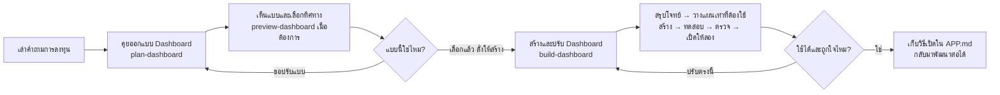

# Flow: คุยจนได้ Dashboard การลงทุนที่ถูกใจ

ช่วงสรุปโจทย์ วางแผน แบ่งงาน สร้าง ตรวจ และปรับต่ออยู่ใน `build-dashboard` ตัวเดียว ผู้เรียนไม่ต้องเรียกคำสั่งแยกทุกขั้น Agent ใช้ขั้นตอนเท่าที่จำเป็นและถามเมื่อมีทางเลือกที่ผู้เรียนต้องตัดสินใจจริง

| ผู้เรียนทำ | Agent ทำ |
|---|---|
| บอกว่าอยากรู้อะไรและใช้งานแบบไหน | ถามให้ชัด จดใน BRIEF.md และเสนอทางเลือก |
| เลือกหน้าตาหรือบอกสิ่งที่ยังไม่ใช่ | ทำแบบให้เห็นและปรับตาม feedback |
| ใช้ build-dashboard สร้างจากแบบที่เลือก | สรุปโจทย์ สร้าง ทดสอบ ตรวจ และเปิดผลงานให้ลอง |
| ลองใช้และบอกสิ่งที่อยากเปลี่ยน | แก้จุดนั้น ตรวจผล และอัปเดตวิธีเปิดใน APP.md |

ไม่แน่ใจจะเริ่มตรงไหนใช้ `choose-skill` ส่วน `setup-project` ใช้เมื่อต้องเปลี่ยนกติกาโปรเจกต์ ไม่ใช่ขั้นบังคับก่อนเริ่ม

เริ่มจาก [START.md](../START.md) ดู [คู่มือคลาส](class-guide.md) และ [ชื่อสกิลทั้งหมด](skills.md)
