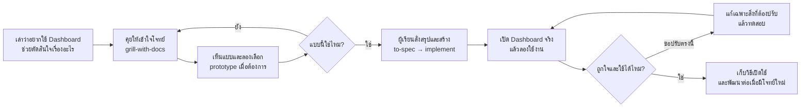

# Flow: คุยจนได้ Dashboard การลงทุนที่ถูกใจ

นี่คือลำดับบทสนทนา ไม่ใช่การสั่งให้สกิลเรียกต่อกันเอง ผู้เรียนเลือกทิศทางและเรียกคำสั่งหลักอย่างชัดเจน จะเอ่ยชื่อสกิลในประโยคปกติก็ได้ ส่วนตัวช่วย เช่น prototype, tdd และ code-review ใช้ตามกติกาของสกิลนั้น

| ผู้เรียนทำ | Agent ทำ |
|---|---|
| บอกว่าอยากรู้อะไรและใช้งานแบบไหน | ถามให้ชัด จดข้อสรุปใน BRIEF.md และแนะนำทางเลือก |
| เลือกหน้าตาหรือบอกสิ่งที่ยังไม่ใช่ | ทำแบบให้เห็นและปรับตาม feedback |
| บอกให้เริ่มสร้าง | สรุปโจทย์ เลือกเทคโนโลยีที่เหมาะ สร้าง ทดสอบ และเปิดให้ลอง |
| ลองใช้และบอกสิ่งที่อยากเปลี่ยน | แก้จุดนั้น ตรวจผล และเก็บวิธีเปิดใน APP.md |

เริ่มจาก [ข้อความใน START.md](../START.md) ใช้ [คู่มือคลาส](class-guide.md) ระหว่างเรียน และดู [รายการสกิล](skills.md) เมื่อต้องการเลือก workflow อื่น

งานเล็กใช้ to-spec กับ implement ก็พอ เมื่อมีงานหลายส่วนค่อยให้ผู้เรียนเรียก to-tickets หรือ implement-spec ไม่ต้องผ่านทุกสกิลก่อนมี Dashboard เวอร์ชันแรก
