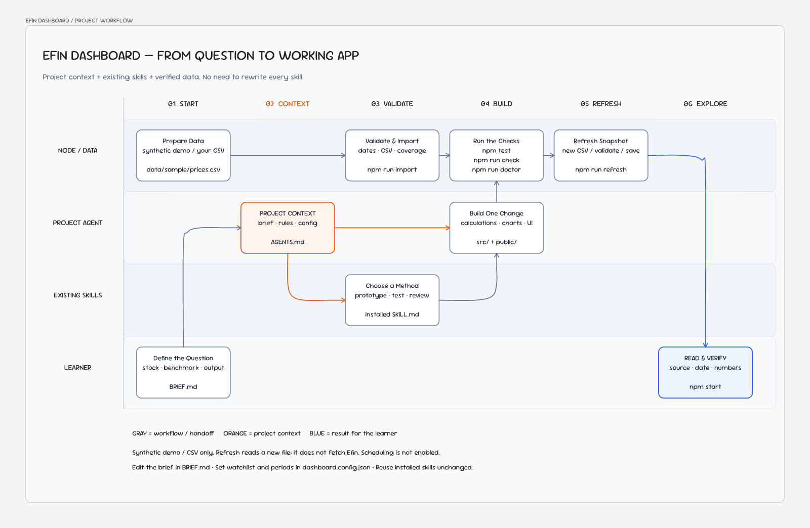

# Flow ของคลาส: จากโจทย์สู่ Dashboard ที่ตรวจผลได้



[เปิด Flow ใน Drawdy](https://drawdy.io/?canvas=6ad6183c2f137995e483f079&token=Rq_d1IExXEJ50zIHSN0tnw) — ลิงก์สำหรับดูโดยไม่ต้องมีบัญชี ส่วนเจ้าของแก้ไขได้จากบอร์ดของตัวเอง

แผนภาพแสดงการส่งต่องานระหว่างผู้เรียน Agent, Skills และคำสั่งของโปรเจกต์ ไม่ใช่ระบบอัตโนมัติที่เรียกทุกขั้นต่อกัน เปิดตัวอย่างด้วย `npm start` ได้ทันทีจากข้อมูลจำลอง ไม่ต้องนำเข้า CSV หรือตั้งเวลาก่อน

## 6 ช่วงของการเรียน

| ช่วง | ทำอะไร | จุดที่ใช้และผลที่ตรวจได้ |
|---|---|---|
| **01 Start — ตั้งโจทย์และเตรียมข้อมูล** | ผู้เรียนระบุคำถาม หุ้น benchmark และสิ่งที่อยากเห็น เริ่มจากข้อมูลจำลอง หรือเตรียม CSV ที่มีสิทธิ์ใช้ | เติม `BRIEF.md` ตาม `templates/dashboard-brief.md`; ข้อมูลเริ่มต้นอยู่ใน `data/sample/prices.csv` |
| **02 Context — ให้ Agent เข้าใจโปรเจกต์** | อ่านกติกาและโจทย์จากจุดกลาง แล้วกำหนดขอบเขตการเปลี่ยนแปลงเล็กหนึ่งอย่าง | `AGENTS.md`, `BRIEF.md`, `dashboard.config.json`; ค่าหุ้นและช่วงคำนวณต้องตรงกับข้อมูล |
| **03 Validate — เลือกวิธีและตรวจข้อมูล** | เลือก Skills ที่ติดตั้งและอนุญาตให้เรียกจริง ตรวจ schema วันที่ benchmark และประวัติที่ใช้คำนวณก่อนรับ CSV | `docs/upstream-skills.md`, `docs/data-contract.md`, `scripts/import.mjs`, `src/data.js`, `src/snapshot.js` |
| **04 Build — สร้างและตรวจผล** | Agent ใช้วิธีทำงานที่เหมาะเพื่อเปลี่ยนสูตรหรือหน้าจอ แล้วตรวจทั้งโค้ดและข้อมูลที่นำเข้า | `src/metrics.js`, `public/app.js`, `public/styles.css`; รัน `npm test`, `npm run check`, `npm run doctor` และตรวจหน้าเว็บ |
| **05 Refresh — อัปเดตเมื่อมีข้อมูลใหม่** | เมื่อพร้อมใช้ CSV ของตัวเอง นำไฟล์รอบใหม่มาตรวจและบันทึกด้วยคำสั่งเดิมที่ทดสอบแล้ว ขั้นนี้เป็นทางเลือกและทำในเครื่อง | `npm run refresh -- "/absolute/path/latest.csv"`; ชุดข้อมูลที่ผ่านอยู่ใน `data/private/current.json` |
| **06 Explore — อ่านและตรวจด้วยตัวเอง** | ผู้เรียนเปิด Dashboard ตรวจที่มา วันที่ล่าสุด หุ้นเทียบ benchmark และคำนวณตัวเลขหนึ่งค่าซ้ำ ก่อนตั้งคำถามรอบใหม่ | `npm start` → `http://localhost:3100`; ใช้ `docs/acceptance-checklist.md` |

## ใครรับผิดชอบอะไร

| Lane | บทบาท |
|---|---|
| **Node / Data** | อ่านและตรวจ CSV คำนวณ snapshot รัน checks และบันทึกข้อมูลในเครื่อง |
| **Project Agent** | อ่านบริบท เลือกขอบเขต ทำการเปลี่ยนแปลง และรวบรวมหลักฐานว่าใช้งานได้ |
| **Existing Skills** | ให้ขั้นตอนที่ใช้ซ้ำ เช่น prototype, testing, debugging และ review ตาม Skills ที่มีจริงและกติกาการเรียกของแต่ละตัว |
| **Learner** | ตั้งโจทย์ จัดหาข้อมูลที่มีสิทธิ์ใช้ อ่านผล และตัดสินว่าตรงความต้องการหรือไม่ |

**เปลี่ยนบริบทของคลาสที่โปรเจกต์ ไม่ต้องแก้ Skills เดิมทุกตัว** เก็บโจทย์ใน `BRIEF.md` ค่าหุ้นและช่วงเวลาใน `dashboard.config.json` และกติกากลางใน `AGENTS.md` โปรเจกต์ใช้งานได้แม้ไม่มี Skills เพิ่มเติม และ Agent ต้องไม่เรียก Skill ที่สงวนให้ผู้ใช้เริ่มเองโดยอัตโนมัติ

## เส้นทางข้อมูลที่ใช้ได้จริง

เริ่มตัวอย่างจาก root ของ repo ด้วย Node.js 22 ขึ้นไป:

```bash
npm run doctor
npm start
```

เมื่อมี CSV ของตัวเอง ให้ปรับ config และทำตาม [Data contract](data-contract.md) ก่อนรัน:

```bash
npm run import -- "/absolute/path/input.csv"
npm test
npm run check
npm run doctor
```

การเลือก CSV ในเบราว์เซอร์เป็น **การดูตัวอย่าง** ไม่แทนที่ข้อมูลหลัก การนำเข้าผ่าน CLI เท่านั้นที่บันทึก `data/private/current.json` ซึ่งไม่เข้า Git แล้วจึงโหลด snapshot ใหม่บน Dashboard เพื่อตรวจผล

`npm run refresh` ใช้ `scripts/import.mjs` ตัวเดียวกับ `npm run import` จึงอ่านไฟล์ที่ระบุ ไม่ดาวน์โหลดข้อมูลจาก Efin ต้องเตรียม CSV รอบใหม่ก่อน หาก validation ไม่ผ่านจะเก็บชุดข้อมูลดีเดิมไว้ และการรันไฟล์เดิมซ้ำไม่ทำให้วันที่ราคากลายเป็นวันใหม่

Starter **ยังไม่มี Efin API adapter และยังไม่เปิดงานตั้งเวลา** หากต้องการต่อยอด ให้อ่าน [Scheduling](scheduling.md) หลังทดสอบ refresh ด้วยมือสำเร็จ การผ่าน tests ไม่แทนการตรวจที่มาของข้อมูล วันที่ และตัวเลขบนหน้าจอ

## ดูแลแผนภาพ

ต้นฉบับที่แก้ได้อยู่ใน Drawdy ภาพใน README เก็บไว้ที่ [workflow.png](assets/workflow.png) เพื่อให้แสดงได้โดยไม่ต้องเปิดบอร์ด มี [snapshot ขององค์ประกอบ](assets/workflow.drawdy.json) สำหรับตรวจเทียบเวอร์ชัน ซึ่งไม่ใช่รูปแบบไฟล์สำหรับนำเข้า Drawdy โดยตรง เมื่อแก้บอร์ดให้ปรับภาพและ snapshot ใน repo ให้ตรงกันด้วย
